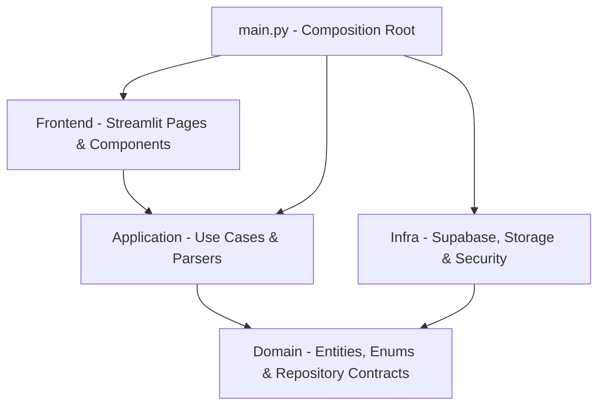
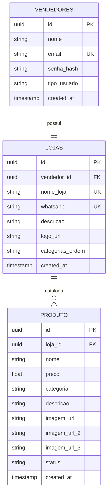

# Vitrine Digital

Plataforma web *mobile-first* de catálogos digitais e gestão comercial para microempreendedores e pequenos negócios. O sistema permite que lojistas gerenciem seus produtos, organizem categorias e compartilhem um link público para recebimento de pedidos estruturados diretamente via WhatsApp.

O projeto foi estruturado aplicando **Domain-Driven Design (DDD)**, **Clean Architecture** e princípios **SOLID**, garantindo desacoplamento entre regras de negócio, interface gráfica e infraestrutura de dados.

---

## Funcionalidades

- **Vitrine Pública (*Mobile-First*):**
  - Acesso via link exclusivo codificado por loja (`?loja=<token>`).
  - Filtragem dinâmica por categorias ordenadas pelo lojista.
  - Visualização de até 3 imagens por produto, montagem de pedido e envio formatado para o WhatsApp da loja.
- **Painel do Lojista:**
  - Autenticação por e-mail/senha e recuperação de acesso validada via e-mail + WhatsApp cadastrado.
  - Cadastro, edição, exclusão e controle rápido de disponibilidade (`disponivel` / `esgotado`).
  - Importação em massa de produtos via bloco de texto estruturado (*parser* dedicado).
  - Personalização de perfil da loja, upload de logotipo e ordenação de exibição das categorias.
- **Administração Global:**
  - Visão consolidada das lojas cadastradas e acesso administrativo para suporte operacional.

---

## Arquitetura do Projeto

A regra de dependência aponta estritamente de fora para dentro: as camadas internas (`domain` e `application`) não possuem dependências de frameworks externos como Streamlit ou Supabase.



### Estrutura de Diretórios

```text
vitrine_digital/
├── main.py                          # Composition Root e roteamento principal
├── pytest.ini                       # Configuração da suíte de testes
├── requirements.txt                 # Dependências do projeto
├── src/
│   ├── domain/                      # Núcleo de negócio puro (sem dependências externas)
│   │   ├── entities/                # Entidades com autovalidação (Vendedor, Loja, Produto)
│   │   ├── enums/                   # Tipos e status de domínio
│   │   ├── repositories/            # Contratos abstratos (ABC)
│   │   └── exceptions.py            # Exceções semânticas de negócio
│   ├── application/                 # Orquestração dos fluxos do sistema
│   │   ├── parsers/                 # Conversor de texto em lote para entidades
│   │   └── use_cases/               # Casos de uso (auth, loja, produto)
│   ├── infra/                       # Implementações técnicas e adaptadores externos
│   │   ├── database/                # Configuração e cliente singleton do Supabase
│   │   ├── mappers/                 # Tradução entre registros relacionais e entidades
│   │   ├── repositories/            # Repositórios concretos Supabase
│   │   ├── security/                # Hashing de senhas e codificação de tokens de URL
│   │   └── storage/                 # Integração com Supabase Storage
│   └── frontend/                    # Camada de apresentação desacoplada
│       ├── components/              # Componentes visuais reutilizáveis
│       ├── pages/                   # Telas da vitrine, autenticação e painéis
│       └── styles/                  # Folha de estilos CSS (Light/Dark Mode)
└── tests/
    ├── conftest.py                  # Repositórios em memória (In-Memory Fakes) e fixtures
    ├── unit/                        # Testes isolados de entidades, parsers e segurança
    └── integration/                 # Testes de fluxos completos, carga e concorrência
```

---

## Modelagem de Dados

O banco relacional (PostgreSQL/Supabase) separa identidade de acesso (`vendedores`), perfil comercial (`lojas`) e catálogo (`produtos`):



---

## Tecnologias Utilizadas

- **Linguagem:** Python 3.11+
- **Interface Web:** Streamlit
- **Banco de Dados e Storage:** Supabase (PostgreSQL + Storage Buckets)
- **Testes Automatizados:** Pytest

---

## Execução Local

1. **Clone o repositório e instale as dependências:**
   ```bash
   git clone <url-do-seu-repositorio>
   cd vitrine_digital
   pip install -r requirements.txt
   ```

2. **Configure as credenciais do Supabase:**
   Crie o arquivo `.streamlit/secrets.toml` na raiz do projeto:
   ```toml
   SUPABASE_URL = "sua_url_do_supabase"
   SUPABASE_KEY = "sua_chave_anon_ou_service_role"
   ADMIN_EMAIL = "admin@vitrinedigital.com"
   ADMIN_PASSWORD = "sua_senha_admin"
   ```

3. **Inicie a aplicação:**
   ```bash
   streamlit run main.py
   ```

---

## Suíte de Testes

Os testes utilizam implementações em memória dos contratos de repositório (`tests/conftest.py`), permitindo validar regras de domínio, fluxos ponta a ponta, importação em massa de 1.000 itens e concorrência sem depender de conexão externa:

```bash
python -m pytest
```
